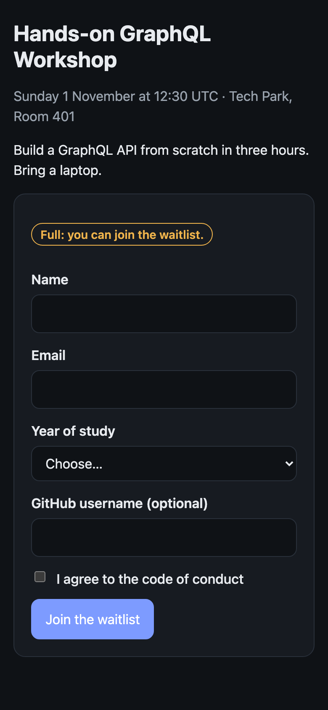
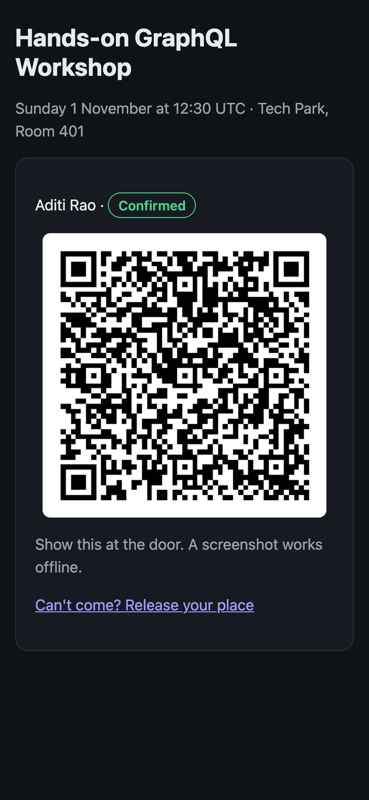
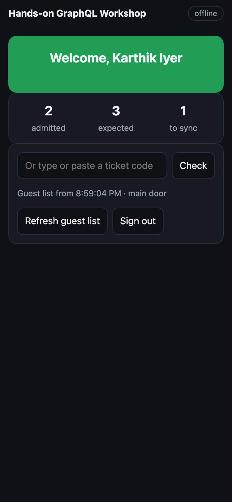

# Event backend

**Registration, waitlists, RSVP reminders and QR check-in for community events, built
so that a rush of sign-ups cannot overbook a room and a door with no signal still works.**

| Register | Ticket | Door scanner, offline |
|---|---|---|
|  |  |  |

## What it guarantees

- **No overbooking under load.** Each registration takes a row lock on its event, and the
  database refuses a seat count above capacity. 10,000 people registering twice each over
  real HTTP, 400 at a time, for 2,000 seats: exactly 2,000 confirmed, every waitlist
  position used once.
- **Double submits and retries are harmless.** One registration per email per event; every
  email goes through a transactional outbox with a deduplication key; scanner syncs carry
  scan ids.
- **No place is wasted.** Cancel, decline or miss the RSVP deadline and the seat goes to the
  first person on the waitlist in the same transaction, with their ticket emailed. Reminders
  go out before the event, and organisers can choose to release places from people who never
  answered.
- **Tickets verify offline.** QR codes are Ed25519-signed; the scanner app checks them on the
  device against a cached guest list, queues scans, and syncs when the network is back. If
  two offline doors admit the same ticket, the earliest scan wins and the later door is told.
- **Each credential does one job.** Organiser tokens, per-door scanner tokens, and ticket
  and RSVP links each unlock exactly one thing; only hashes of tokens are stored.

The reasoning behind each, and the load numbers: [docs/design.md](docs/design.md). The
endpoints: [docs/api.md](docs/api.md).

## Run it

Needs Node 22.18 or newer (TypeScript runs natively, no build step) and PostgreSQL 16's
binaries (`brew install postgresql@16`, or `apt install postgresql-16`). No Docker.

```bash
npm install
npm run demo
```

`npm run demo` starts a throwaway database, the API and its email worker, creates a
published event with a waitlist and a door scanner, and prints links to the registration
page, a ticket, the scanner and an organiser API token. Emails land in `./outbox` as
`.eml` files you can open in any mail client: each confirmation carries the QR code inline
and a calendar invite.

Against your own database:

```bash
cp .env.example .env                                   # set DATABASE_URL and APP_SECRET
node --env-file=.env src/cli.ts migrate
node --env-file=.env src/cli.ts create-organizer you@example.org "Your Name"   # prints a token
node --env-file=.env src/server.ts
```

Production email uses Amazon SES (`EMAIL_TRANSPORT=ses`, credentials from the standard AWS
chain). Set `RUN_WORKER=false` and run `npm run worker` separately to scale the API and the
email worker independently; several workers can run at once.

## Checks

```bash
npm run typecheck     # TypeScript, strict
npm test              # 34 tests against a real PostgreSQL started for the run
npm run bench:race    # registration rush; add "10000 2000 400" for the large run
```

The tests start their own PostgreSQL in a temp directory, or use `TEST_DATABASE_URL` if set
(as CI does). Each test file gets a fresh database cloned from a migrated template.

## Repository

```
src/
  domain/        events, registrations and waitlist, RSVP, check-in, organisers, forms
  email/         outbox, rendering, MIME, iCalendar, transports (SES, file), worker
  http/          routes, middleware, the three server-rendered pages
  db/            pool, migrator, SQL migrations
  crypto.ts      Ed25519 tickets, sealed keys, magic links, tokens
public/          the door scanner app (works offline)
scripts/         local PostgreSQL, demo, load test
test/            unit, registration, concurrency, check-in, email and RSVP, HTTP
results/         load test results (JSON)
```

## History

I wrote the first version of this backend from scratch for Alexa Developers SRM, the
student developer community at SRM Institute of Science and Technology, between 2021 and
2023. It handled registration, automatic RSVP emails and QR attendance with Express,
TypeScript, Supabase and PostgreSQL, AWS SES and S3, deployed on Heroku and Azure, and it
ran at live events.

This repository is a ground-up rewrite (2026). It keeps the core of the stack (Express,
TypeScript, PostgreSQL, SES) and is designed around the ways community events usually go
wrong: registrations arrive as a rush, people submit twice, some never turn up, and the
venue's network is weakest when the queue at the door is longest.

## Licence

The code is released under the [MIT License](LICENSE).
